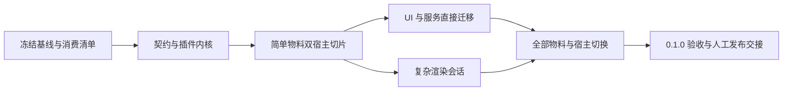

# 物料能力装配层交付路线

入口：[重构地图](./map.md)。2026-10-11：架构、完整切换和验收方案已经逐票确认。下列阶段落实已确认决议；2026-10-13 **完整重构与 0.1.0 候选实际验收已完成**，最终交接见 [G6](./implementation/G6.md)，正式 Gate 状态以 runbook 为准；用户自行发布。

源码研究基线：`0b43cb752ddd13b1802bbbb0d3b2993a3a8fd3be`；审查基线：`042619cd952c9c32ffe66dab874193b7c99e27d6`。本页只记录阶段、依赖、验收和交接，契约细节以对应票据 Answer 为准。

已编译为 [Implementation Plan](./implementation-plan.md)：G0–G6 分别对应下列阶段零至六，含修改边界、slice、检查和退出映射。Goal Loop 使用线性恢复顺序，UI（G3）先于会话（G4），不改变原有技术依赖。执行状态只存于 [runbook](./goal/runbook.md)，后续使用[固定提示词](./goal/prompt.md)接续。

## 已确认目标与不变量

- Schema、codec、migration、持久化版本与节点工厂语义不变；SDK 0.1.0 不等于文档 Schema 升级。
- 物料集中定义模型、宿主 renderer 及可选 UI、locale、properties、AI，由框架内部装配；用户选择完整物料，builtin 只组合。
- 分阶段实现与评审，完整重构后一次交付；本次重构中间态不作为 0.0.x 发布。
- 旧 API 直接删除，不开发兼容层、双 registry、旧 bundle 投影视图或 Store Contribution 桥。
- 安装失败回滚、宿主销毁、异步代次失效是首版承诺；切换插件集合需销毁重建。
- 0.1.0 候选产物和验收齐备后交用户手动发布；实施任务不自动 publish/tag。

既有正常文档/输出行为按冻结夹具保持。新 API 的重复物料/插件身份、创建/销毁方式和旧入口删除属于明确的 breaking changes。翻译缺失或词条冲突允许降级运行，按生命周期票据确定选值及非阻断诊断；不得将所有 key 冲突统一视为启动失败。未知物料的可见诊断属于需要单独验收的运行时改进。

## 设计内容在哪里

| 内容 | 唯一决策票据 |
| --- | --- |
| 完整物料入口、宿主隔离、受控上下文与内核分工 | [确定能力契约、宿主裁剪与包依赖方向](./issues/04-contract-boundaries.md) |
| 启动事务、依赖、冲突、locale、Scope 与清理 | [确定插件安装事务、所有权与清理语义](./issues/05-host-lifecycle.md) |
| 完整物料字段、目录、AI、共享模型与 builtin 组合 | [确定物料能力的单一来源与 builtin 组合职责](./issues/06-material-contributions.md) |
| Designer UI payload/context、命令服务与应用预览壳层边界 | [确定 UI Slot、宿主服务与旧 Contribution 的迁移边界](./issues/07-ui-slots.md) |
| 会话 factory、runtimeRef、table 状态、输出寿命 | [确定 Render Session 与复杂物料状态传递协议](./issues/08-render-session.md) |
| 旧入口删除、全宿主迁移、版本与人工发布 | [确定 0.1.0 破坏性切换、旧 API 删除与手动发布边界](./issues/09-compatibility-cutover.md) |
| 验证层次、基线、正式文档与发布证据 | [确定验收门禁、发布标准与持续文档归属](./issues/10-quality-documentation.md) |

## 阶段路线

以下阶段落实已确认的完整物料入口、直接受控上下文、每实例唯一装配内核、生命周期、UI 和输出契约。验收细则以质量票据的最终决议为准；阶段描述不能重新引入已撤回的能力拼装或服务清单。

这些阶段是同一重构的开发检查点，不是逐阶段公开发布。未迁移代码可以在工作分支中短暂存在，但不能通过兼容桥接接入新 Host，也不能作为阶段已完成的证明。任何可交接提交须达到该阶段检查要求；完整用户路径不通的中间状态不发布。源码检查点回退通过 Git/版本恢复并重新构建，不做运行时双模式。

### 阶段零：冻结行为、依赖与消费入口

- 固定 canonical 文档/数据及现有 normalize/codec 输出，包含未知类型、自定义字段、条件、绑定、单位、图表、表格、分页与页码。
- 冻结 all/basic/none、实际目录/预设/order、模型默认值、binding、locale 查找和活动 AI manifest；useTokens 目前无消费者，不借迁移新增实现。
- 枚举旧 API/类型/exports/重导出、可写 registry 及全部消费者；按破坏性切换票据标注删除项和保留的非装配能力。
- 获取最小 Viewer 产物图和声明图，作为依赖隔离与导出验收证据；性能基线暂不作为阶段零要求。启动/渲染/大表格行为继续用既有夹具和功能测试核对，资源所有权按生命周期和会话测试验证。
- 列出 0.1.0 同步发布的公共包，以及 private runtime、Go/Android 内嵌制品的匹配关系。

退出门禁：既有行为能复现，既有失败有记录，消费与删除清单覆盖实际宿主，Viewer 依赖图和声明图符合隔离要求。性能数据暂不作为前置条件；若实施中发现可复现回归，再增加针对性门禁。不能改 Schema 来使夹具通过。

### 阶段一：契约、唯一内核与新宿主启动

- 创建 plugin-api/runtime，按已决 exports 拆类型与实现；把票据最小契约落为真实类型、声明入口和正/负向消费 fixture。
- 实现框架内部能力登记与核心组合校验，能力回调直接取得受控上下文；暂存事务、资源范围/代次和分级诊断按生命周期决议落实。不实现通用插件依赖解析器或安装排序配置，不要求作者填写服务清单。
- 实现 Promise 创建、active 后禁止装配和可等待 destroy；同一 Scope 注册失败不可捕获后继续提交。
- Designer/Viewer 接入新创建配置，宿主上下文由框架内部提供；能力存储由 runtime 唯一拥有。删除已替换注册 Map，不让旧 Store/Viewer 写入口转发到新内核。
- 该阶段暂不搬 UI 布局或分页算法。受控服务只暴露查询/显式命令，不暴露 Store。

退出门禁：完整物料、集合与非物料 UI/命令的类型消费闭合，上下文直接提供；启动/冲突/locale/销毁按生命周期决议验证；双 Host 隔离；Viewer 最小声明无 Vue；无双存储或旧 API façade。尚未迁移的应用调用在后续阶段直接更新，不能为让旧调用编译添加兼容层。

### 阶段二：text / image 双宿主完整切片

- 每个物料包集中维护领域定义、两端实现、目录、文案与 AI，输出宿主隔离的完整物料；复用现有算法。
- binding、condition/pageAware 与节点工厂下放到共享模型；属性、目录、locale、AI 随完整物料提供，builtin 只选择成员清单。
- 建立最小 Designer 与无 UI Viewer 消费 fixture，覆盖完整物料和自行组合，验证两端领域定义一致且无需手动补齐能力插件。
- 文档引用未安装物料时可见占位与结构化诊断，原 canonical 节点不变；所选完整物料缺模型或核心 renderer/loader 是配置错误，创建失败。已经声明的惰性实现加载失败按运行时局部降级处理。
- 以 text/image 导出消费实际检查依赖图；旧根聚合、bundle、register 示例不再作为新切片入口。

退出门禁：绑定、factory/lazy、measure/getRenderSize、属性/撤销/locale/AI 与基线一致；text/image 两端独立可用；增加自定义 renderer 无需改框架；无旧入口调用。

### 阶段三：UI Slot 与受控服务直接迁移

- 在 Designer 实现 UI 票据最终收敛的消费点、响应式 props、局部错误边界与 mount 子范围；不新增 Viewer UI 包或通用 viewer.overlay 扩展点。
- 默认 palette 由 descriptor 渲染；property contribution 继续使用 PropSchemaEditor，特殊 UI 独立挂载。
- 旧 Contribution/activate(ctx.store)/contributions prop 直接替换为插件；Assistant、工具栏、面板、命令、locale 同步迁移。
- PreviewOverlay 继续由应用管理界面，通过 Viewer 公共接口完成预览/输出；保持界面在文档 iframe 输出之外，具体边界见 UI 票据，不要求 UI adapter 配置。

退出门禁：双 Designer 不串 selection/Teleport/locale；工具栏和右键扩展位置/排序正确，物料属性 append/replace-body 范围正确；局部 UI 故障隔离与资源清理有效；table 深层属性与 Assistant 的文档替换/回退语义不退化；无 UI Viewer 正常；旧 Contribution 桥与完整 Store 注入不存在。不新增属性面板通用前后插槽。

### 阶段四：复杂 Render Session 与输出所有权

- 每轮捕获快照、创建 session/generation；候选页面和资源就绪后统一提交，同文档刷新失败保留旧结果，切换文档清预览。
- 有状态物料使用可选会话 factory 替代共享 mutable renderer 状态；可选 prepare 允许异步，measure/paginate/render/getRenderSize 同步；简单物料无需额外生命周期模板。
- 为非持久化 LayoutFragment 传递 runtimeRef，重排/拆分/copies/page-aware 和 toPagePlan 保留关联；Schema 节点不带运行字段。
- 迁移 table-data 的 rows/rowHeights/totalHeight/声明尺寸/片段状态；删除模块级隐式 runtimeLayoutCache。
- 覆盖 text overflow、line、flow-row、page-number、barcode ownerDocument、chart-custom lazy/资源；不重写通用布局和分页算法。
- 实现字体/图片有限等待与诊断降级、局部物料占位、分页进度检查、统一任务结果；打印/导出等待最新结果并固定输出版本，其资源在最后使用方释放后清理。

退出门禁：共享 Schema 双 Viewer、重叠 updateData、字体/prepare/图片等待中 destroy 均隔离；旧任务不提交任何 metrics/诊断/DOM；会话结束不释放仍在显示或输出的资源；运行引用与 resolved props 跨片段保留且不进入 Schema；资源就绪/降级、正常取消与整体失败可区分；正常表格片段与基线一致，源数据不变。

### 阶段五：全部物料和实际宿主切换

- 完成剩余物料，保留 chart/table kernel 领域复用；删除 builtin 私有 binding/renderer/AI 复制定义与全部旧 bundles/registrars。
- 将 playground、PreviewOverlay、Assistant、新创建式 print 配置、internal viewer runtime 切到新入口；跨进程/消息边界只传可序列化数据/选择配置，同源预览不强制增加消息协议。
- 构建并核对实际 Go/Android 内嵌制品链路，运行真实浏览器/打印/导出冒烟。
- 删除旧公共注册 API/类型/可写 registry/重导出；迁移测试、教程和 README 生成源。保留与物料装配无关的 API。

退出门禁：所有内置物料能力和默认集合一致；none 无隐式能力；全仓真实消费者直接使用新入口；最小 Viewer 无 UI 依赖；新增物料只改自身包及组合；没有 legacy adapter、旧 façade 或双实现模式。

### 阶段六：0.1.0 验收与人工发布交接

- 全部重构完成后，按发布清单将本轮现有公共 npm 包及新增 plugin-api/runtime 准备为 0.1.0；核对候选包的实际依赖和 exports，生成候选产物/内嵌 manifest。private 应用与平台制品的匹配方式见破坏性切换决议，不强制更改平台独立版本规则。
- 全量工程与行为测试、API 类型消费、文档构建、产物图、真实宿主和资源清理门禁全部通过。
- 正式架构/开发指南讲已落地边界；release notes 明示破坏性 API、同步迁移的应用调用与旧版本整体回退方式。
- 提供 0.0.x → 0.1.0 代码迁移范例；不得引导安装兼容包或修改文档 Schema。
- 将命令/环境/候选产物/版本清单/未验证项汇总交给用户。发布说明明确现有 release 脚本的重复 bump 风险、新包首次发布前提和 tag 触发远端发布的副作用；由用户手动发布，不自动 release/publish/tag/push。有未验证发布必需项时不宣告可发布。

退出门禁：新接口可消费、旧接口不可消费、所有宿主可运行、文档与制品一致。只有实现验收完成才归档地图；规划 resolved 不能代替发布验收。

## 验证矩阵

| 目标 | 现有或实施时入口 | 通过判据 |
| --- | --- | --- |
| Schema 冻结 | schema codec/defaults/migration/validation 测试；canonical/未知物料夹具 | 持久化字段/版本与既有编解码语义不变 |
| 类型和包契约 | plugin-api/runtime 新公共消费 fixture、package exports 测试 | 完整物料、all/basic/none、自定义物料与独立 UI 消费成立；错误能力声明被拒绝；无循环和用户服务清单 |
| 生命周期 | runtime 公共行为测试 | 核心安装失败整体回滚、最终检查、locale 冲突继续运行及稳定选值、destroy/late resource 所有权确定；无插件依赖排序配置，不实现已撤回的可选插件跳过模式 |
| 模型与集合 | builtin index/designer/condition 测试迁移；model/projection 测试 | all/basic/none、工厂、binding、condition/pageAware 唯一来源 |
| Designer 与 UI | designer-store、material Designer、UI consumer/编辑测试 | selection/drop/resize/undo/overlay、双实例、Assistant 行为一致 |
| Viewer 管线 | viewer、core pagination/reflow、table/text/line/flow-row 测试 | 页数、几何、fragment、resolved props、wrapper、ownerDocument 一致 |
| 会话与输出 | 新 shared Schema / overlap / cancel / replace / destroy 测试 | 最新轮提交，取消不毁旧输出，计算完成不毁新输出，无资源残留 |
| 实际宿主 | print core 测试、render:runtime、render smoke、Go/Android 制品检查 | 新装配到最终产物可运行，清理真正 await |
| 旧 API 删除 | 阶段零删除清单、源码辅助扫描、旧路径负向 exports/类型消费 | 旧 API/类型不可用，无桥接/双存储；非装配 API 未误删 |
| 性能回归 | 仅在实现中出现明显回归时记录受影响场景；常规阶段检查包/声明依赖图和资源清理 | 无已知性能回归；发现回归时有针对性数据和修复证据，不把性能基线作为默认发布门禁 |
| 文档与发布 | check-map、docs:build、实际示例、版本/候选产物清单 | 计划与实现分开，0.1.0 依赖完整，交接手动发布 |

实现变更遵循 [CLAUDE.md](../../CLAUDE.md)：`pnpm build` → `pnpm lint` → `pnpm typecheck`，再记录相关测试；收口 `pnpm test`。浏览器 smoke 入口为 `pnpm -F @easyink/render-api-service test:render-smoke`，前置构建/浏览器配置按实际脚本；`pnpm render:manifest` 包含 runtime 构建。缺环境/skip 记为未验证，happy-dom 不能证明真实字体/打印布局。

纯路线文档修改只运行地图/链接和决议一致性检查，不新增应用测试，也不报告应用门禁通过。

## 防止实施偏移

| 实施变化 | 处理规则 |
| --- | --- |
| 改公共契约、exports 归属、依赖方向、owner、事务失败结果、condition/pageAware 来源 | 停止受影响阶段，回填/重开对应决策并复核下游，再改实现 |
| 改 Session/fragment 身份、prepare 顺序、输出资源寿命、Schema 或默认集合 | 同上；不得以“实现细节”绕过 |
| 加旧 API 兼容桥、发布中间 0.0.x、自动发布 | 与已确认策略冲突，不作为常规实施选择 |
| 选私有函数名、同包内文件组织、等价算法内部优化 | 可由实现任务决定，公共行为与测试门禁必须保持 |
| 性能实测或真实宿主推翻前提 | 记录证据并修订相关决定，不降低门禁伪装通过 |

一个实施任务至少注明所属阶段、决策链接、允许修改包、删除的旧入口、保留行为、公共验收、正式文档、Git 检查点和下一阶段证据。阶段交接逐项列“决议要求 → 实际文件/导出 → 测试/产物证据”，发现差异必须解释；不能只写完成。
